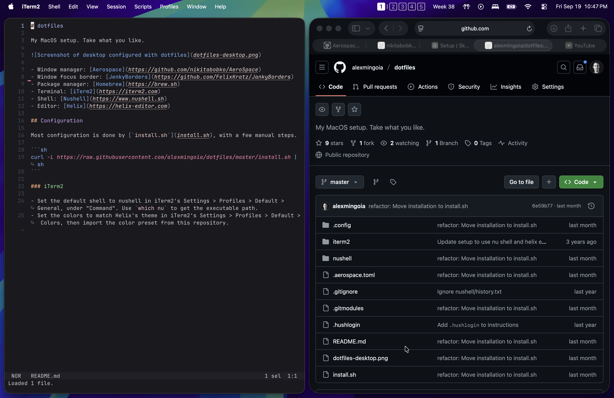

# dotfiles

My MacOS setup. Take what you like.

- Window manager: [Aerospace](https://github.com/nikitabobko/AeroSpace)
- Package manager: [Homebrew](https://brew.sh)
- Terminal: [iTerm2](https://iterm2.com) and [tmux](https://github.com/tmux/tmux/wiki/Getting-Started)
- Shell: [Nushell](https://www.nushell.sh)
- Editor: [Helix](https://helix-editor.com)
- Font: [JetBrains Mono](https://www.jetbrains.com/lp/mono/)
  
## Installation

[`install.sh`](install.sh) installs tools and configuration automatically:

```sh
curl -L https://raw.githubusercontent.com/alexmingoia/dotfiles/master/install.sh | sh
```

## Screenshots


